

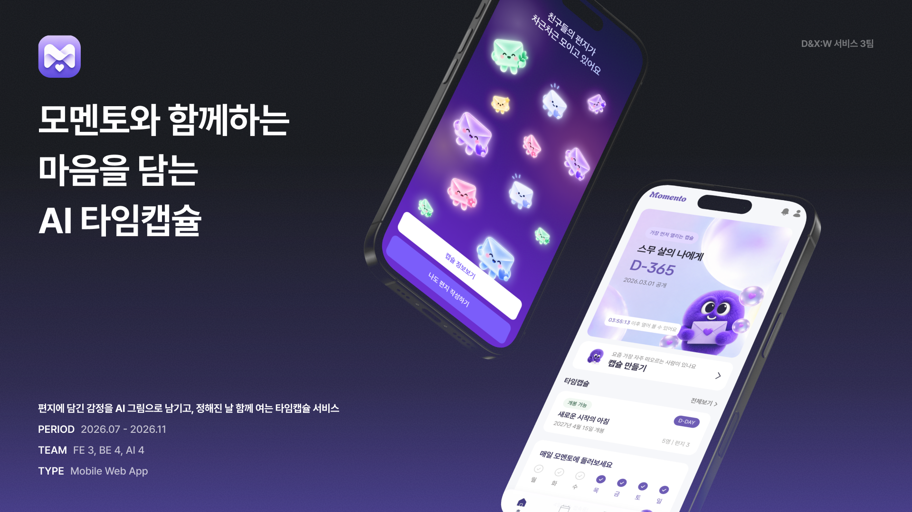

  

# Momento

**편지에 담긴 감정을 AI 그림으로 남기고, 정해진 날 함께 여는 타임캡슐 서비스**

Moment(순간) + Memento(기억을 간직하는 기념품)

[Frontend](https://github.com/D-X-W-Service-3/momento-client) ·
[Backend](https://github.com/D-X-W-Service-3/momento-server)

| 기간 | 팀 | 형태 |
|:---:|:---:|:---:|
| 2026.07 ~ 2026.11 | FE 3 · BE 4 · AI 4 | Mobile Web App |

국민대학교 D&X:W 서비스 3팀

 

## 📌 Overview

흘러가는 메시지 대신 마음을 담아 쓰고, 그날의 감정까지 함께 열어보는 프로젝트입니다.
타임캡슐처럼 편지를 담아두었다가 공개일에 함께 꺼내보고, LLM 이 편지의 감정을 읽어 고른 화풍의 그림으로 함께 남깁니다.

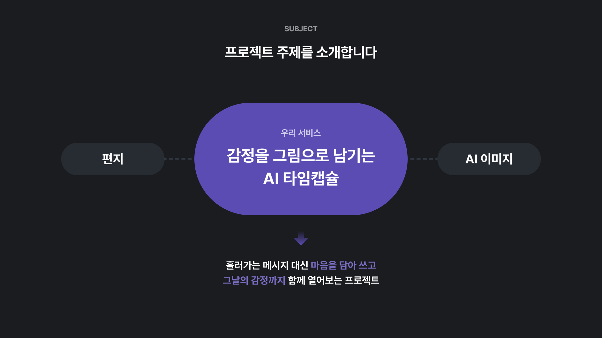

 

## 🔍 Background & Problem

- 10명 중 6명은 최근 1년간 손편지를 쓰지 않았지만, 느린우체통은 전국 324곳에서 여전히 편지를 받고 있습니다.
- 대화는 메신저로 옮겨갔지만 마음을 오래 남길 곳은 없고, 미래편지 서비스는 "나에게 쓰는 편지" 중심이라 함께 쓰는 경험이 부족합니다.

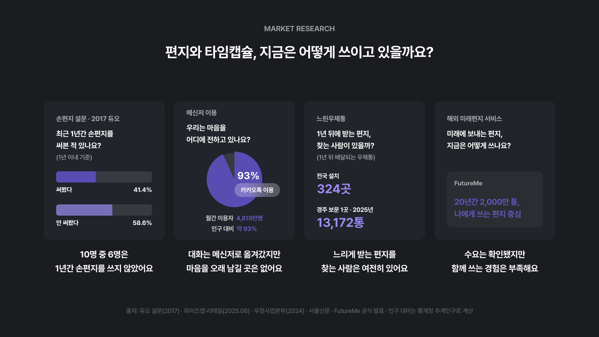

기존 타임캡슐 서비스는 편지를 저장하고 정해진 날짜에 공개하는 데서 끝납니다. Momento 는 세 가지 문제를 이렇게 풉니다.

| 문제 | Momento 의 해결 |
|---|---|
| **단순한 기록과 보관** — 저장하고 공개하는 데서 끝남 | 편지에 그림을 더하고, 공개 후엔 아카이브에서 언제든 다시 꺼내봅니다. |
| **감정 전달의 한계** — 텍스트만으로는 그날의 분위기를 담기 어려움 | LLM 이 편지의 감정을 읽고, 고른 화풍으로 그림을 그려 함께 담습니다. |
| **비어 있는 기다림** — 작성과 공개 사이가 단순한 대기로 끝남 | 편지가 모이는 과정을 보여주고, 공개일에 모두가 함께 열어봅니다. |

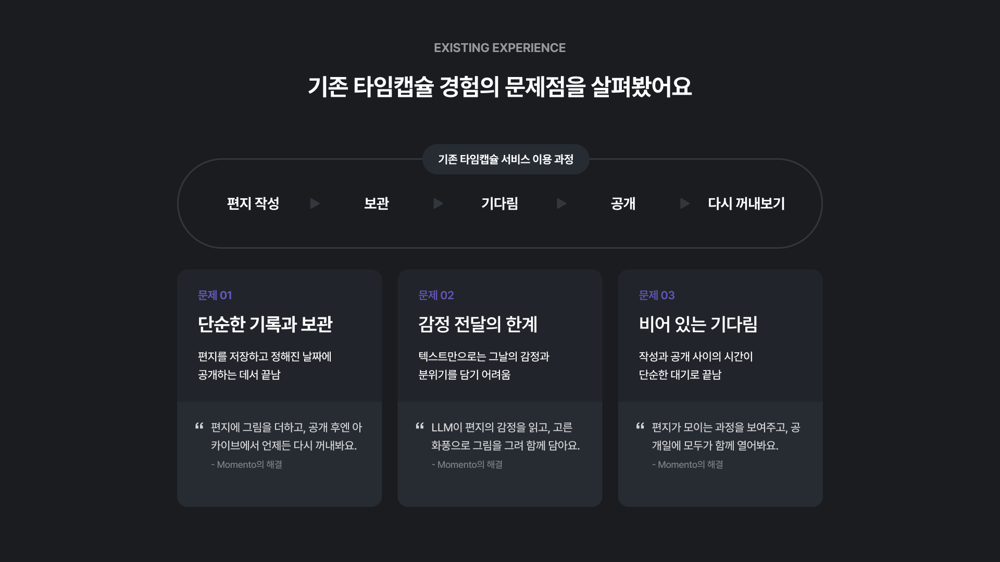

 

## 🎯 Goal

캡슐을 만드는 순간부터 다시 꺼내보는 날까지, 하나의 흐름으로 연결합니다.

| 단계 | 기능 | 설명 |
|:---:|---|---|
| **Create** | 간편한 캡슐 만들기 | 아이콘 · 이름부터 날짜까지 단계별로 고르고 링크로 친구 초대 |
| **Write** | 편지에 그림 더하기 | 편지를 쓰고 화풍을 고르면 AI 가 감정을 읽어 그림으로 표현 |
| **Wait** | 모이는 편지 보기 | 편지가 쌓이는 과정을 시각적으로 보여주고 마감 후엔 D-day |
| **Open** | 함께 열고 간직하기 | 공개일에 모두에게 알림, 편지와 그림을 아카이브에 보관 |

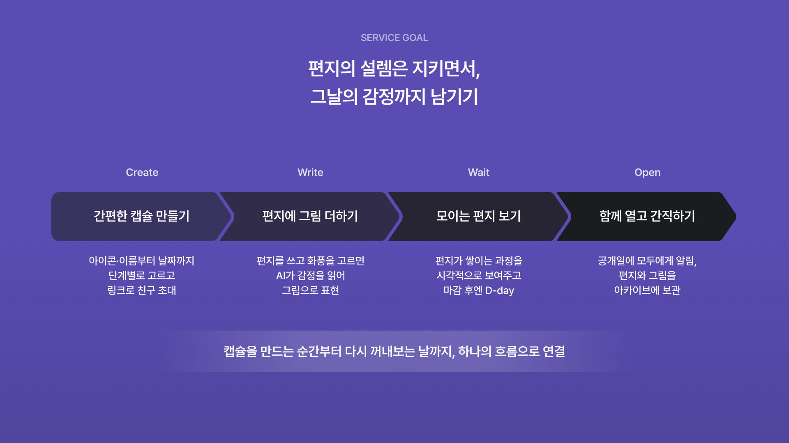

 

## 🎨 Branding

**Moment · Emotion · Memory** — 타임캡슐처럼 마음을 담아두었다가 함께 꺼내보는 서비스

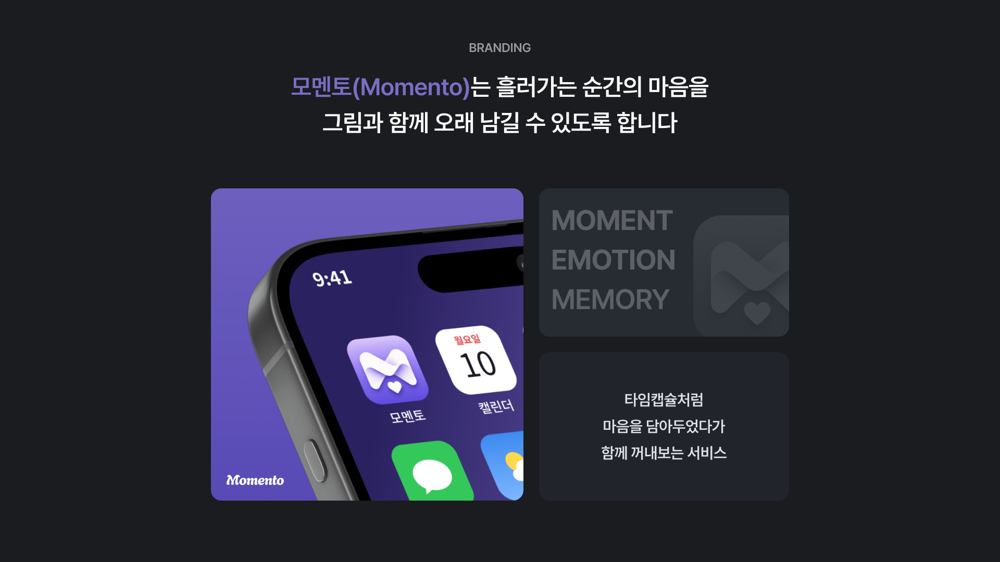

 

## 📱 User Experience

### 01. Create — 캡슐 만들기

아이콘 · 이름 입력 → 공개 범위 · 날짜 선택 → 초대 링크 공유

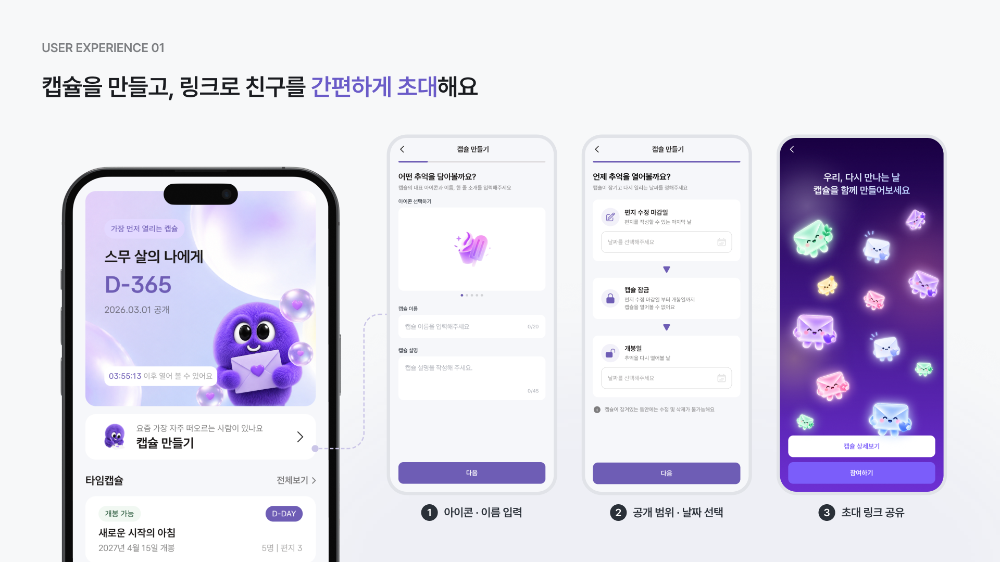

### 02. Write — 편지 쓰기

원하는 화풍을 고르면 AI 가 그림을 그리고, 공개일까지 편지 내용은 비밀로 보관됩니다.

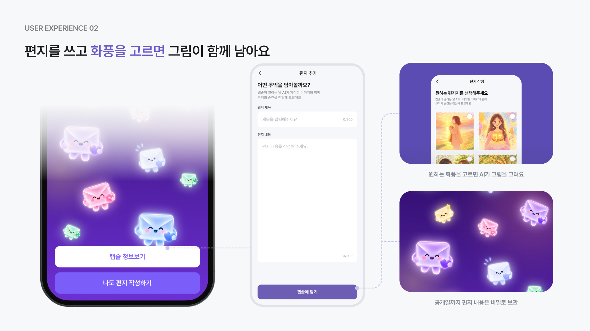

### 03. Wait — 편지가 모이는 시간

편지가 하나씩 떠오르고, 마감 후에는 캡슐이 잠깁니다. 참여자와 수신자를 확인할 수 있습니다.

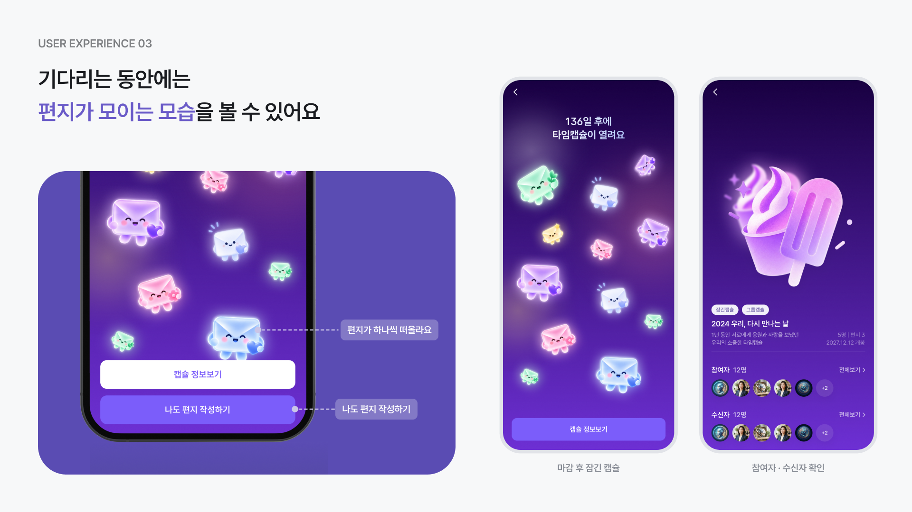

### 04. Open — 함께 열기

공개일 0시에 캡슐이 열리고 알림이 발송됩니다. 편지와 AI 그림을 함께 열어보고 사진과 함께 아카이브에 보관합니다.

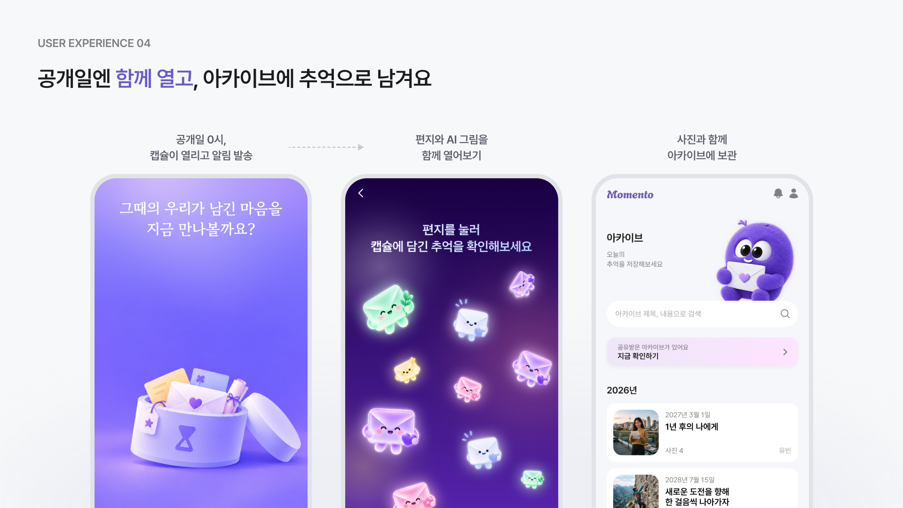

### UI 화면

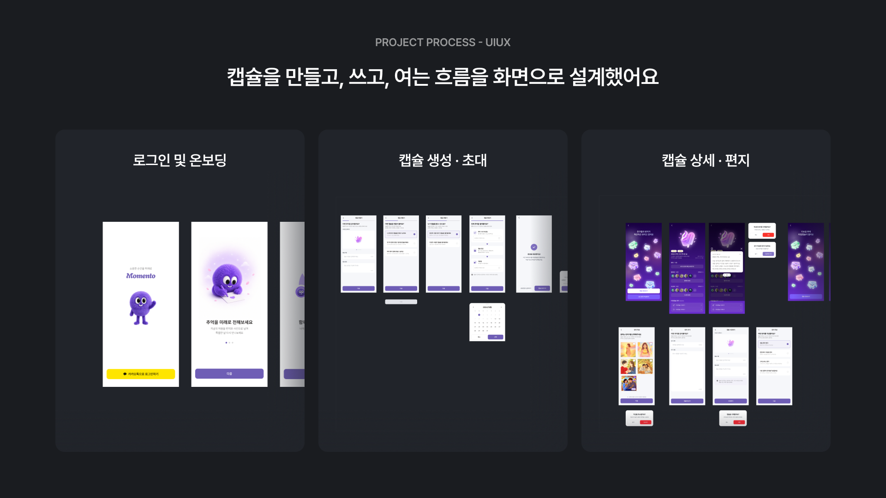

 

## 🏗 System Architecture

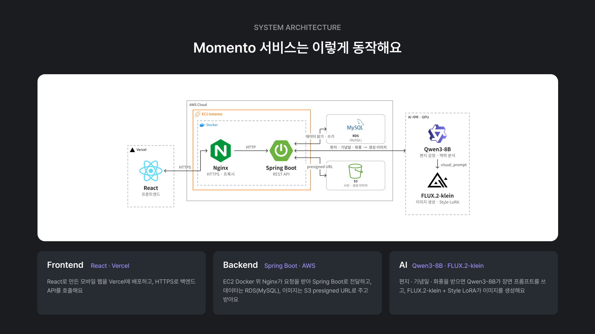

| 파트 | 스택 | 설명 |
|:---:|---|---|
| **Frontend** | React · Vercel | React 로 만든 모바일 웹을 Vercel 에 배포하고, HTTPS 로 백엔드 API 를 호출합니다. |
| **Backend** | Spring Boot · AWS | EC2 Docker 위 Nginx 가 요청을 받아 Spring Boot 로 전달하고, 데이터는 RDS(MySQL), 이미지는 S3 presigned URL 로 주고받습니다. |
| **AI** | Qwen3-8B · FLUX.2-klein | 편지 · 기념일 · 화풍을 받으면 Qwen3-8B 가 장면 프롬프트를 쓰고, FLUX.2-klein + Style LoRA 가 이미지를 생성합니다. |

 

## 🛠 Development

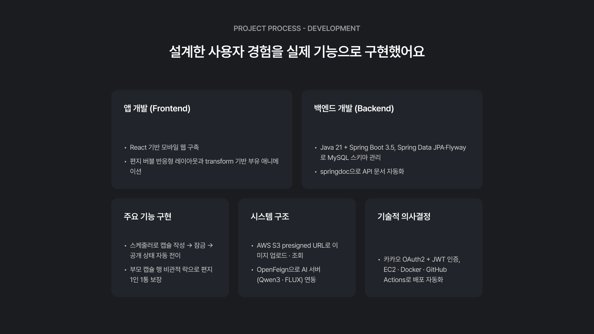

**Frontend**
- React 기반 모바일 웹 구축
- 편지 버블 반응형 레이아웃과 transform 기반 부유 애니메이션

**Backend**
- Java 21 + Spring Boot 3.5, Spring Data JPA · Flyway 로 MySQL 스키마 관리
- springdoc 으로 API 문서 자동화
- 스케줄러로 캡슐 작성 → 잠금 → 공개 상태 자동 전이
- 부모 캡슐 행 비관적 락으로 편지 1인 1통 보장
- AWS S3 presigned URL 로 이미지 업로드 · 조회
- OpenFeign 으로 AI 서버(Qwen3 · FLUX) 연동
- 카카오 OAuth2 + JWT 인증, EC2 · Docker · GitHub Actions 로 배포 자동화

 

## 🤖 AI — 편지의 감정을 읽고, 그림으로 그려요

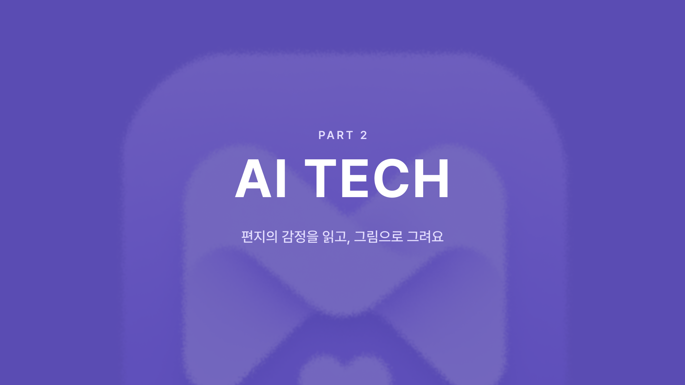

| 단계 | 내용 |
|:---:|---|
| 01 | 편지 작성 및 옵션 선택 — 편지를 작성하고 카테고리와 원하는 화풍을 고릅니다. |
| 02 | 편지의 감정과 맥락 분석 — Qwen3-8B 가 편지를 읽고 감정과 맥락을 파악합니다. |
| 03 | 장면 프롬프트 작성 — 편지 속 장소와 인물의 행동을 장면으로 씁니다. |
| 04 | 카테고리 · 화풍 정보 반영 — 장면 설명에 사용자가 선택한 옵션을 더합니다. |
| 05 | 일러스트 생성 — FLUX 가 완성된 프롬프트로 그림을 그립니다. |

- **선택 카테고리**: 기본 · 생일 · 연인 기념일 · 크리스마스
- **선택 화풍**: 파스텔 · 수채화 · 민화풍 · 빈티지 · 애니메이션

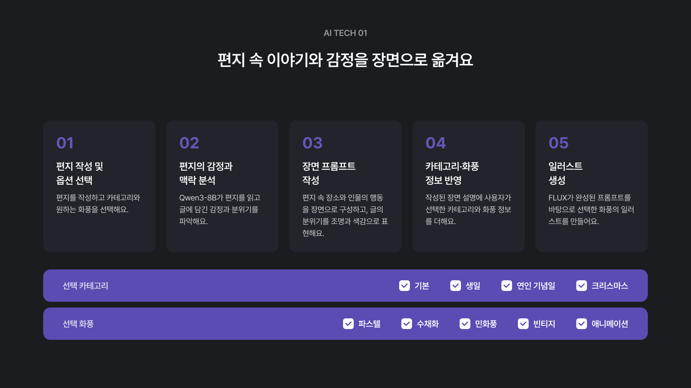
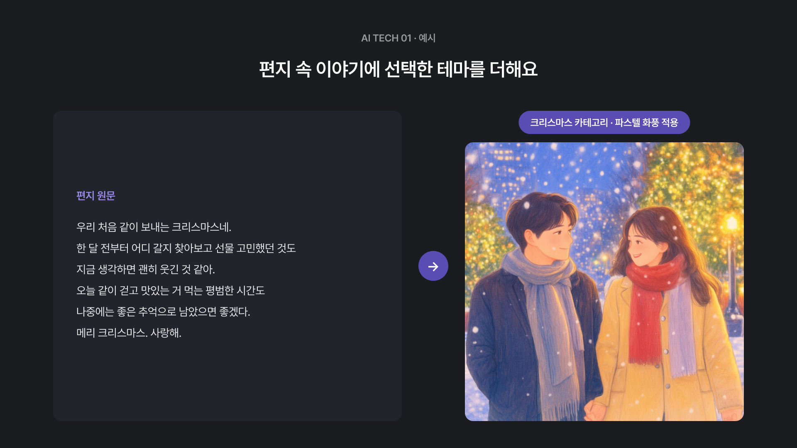
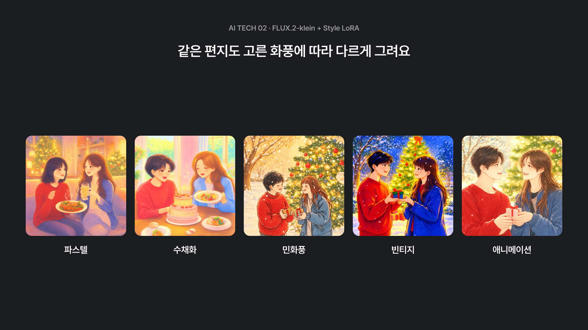

 

## 🤝 Collaboration

세 파트가 함께 고민하며 완성했습니다.

- **Figma 를 통한 화면 및 디자인 공유** — 확정 디자인과 컴포넌트를 기준으로 화면을 맞추고 코멘트로 소통
- **API 명세서로 파트 간 인터페이스 합의** — FE · BE · AI 가 요청 · 응답 형식을 명세서로 먼저 맞추고 구현
- **GitHub 이슈 · PR 리뷰로 코드 협업** — 이슈 단위로 작업을 나누고, PR 리뷰를 거쳐 develop 에 반영

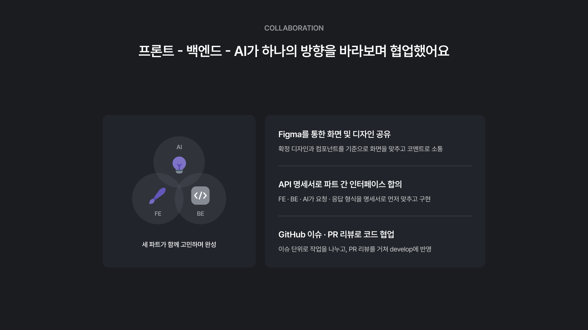

 

## 👥 Team

| Frontend (3) | Backend (4) | AI (4) |
|---|---|---|
| 이승준 (팀장) | 이상래 (팀장) | 윤성철 (팀장) |
| 이유빈 | 동승환 | 박종은 |
| 김승혁 | 주민건 | 김현도 |
| | 이서현 | 김동훈 |

 

## 📦 Repositories

| 저장소 | 설명 |
|---|---|
| [momento-client](https://github.com/D-X-W-Service-3/momento-client) | React 19 + TypeScript 모바일 웹 (Vite · Tailwind CSS · TanStack Query · PWA) |
| [momento-server](https://github.com/D-X-W-Service-3/momento-server) | Java 21 + Spring Boot 3.5 REST API (JPA · Flyway · OAuth2 · S3 · OpenFeign) |
